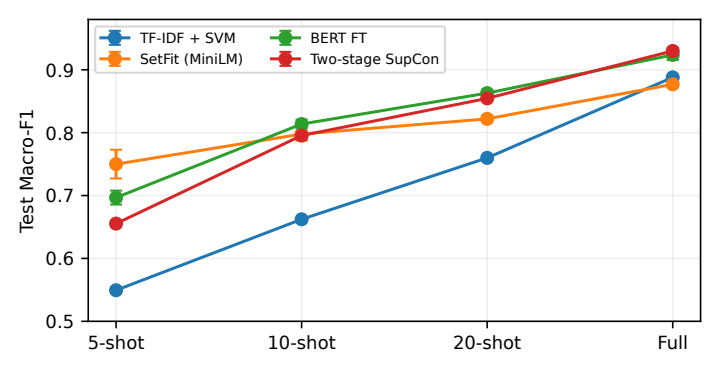
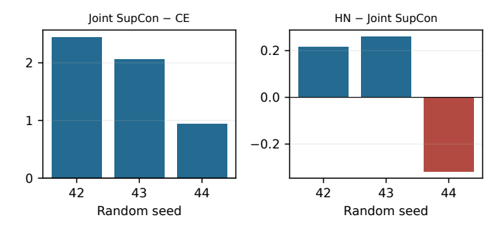

# Does Supervised Contrastive Training Improve BERT for Five-Shot Banking Intent Classification?

jingzhe FENG · City University of Hong Kong (Dongguan) · Student ID: 72655564

## Abstract

Banking support systems must distinguish requests that use similar words but require different actions. With only five training queries per intent, few examples show which differences matter. We compare a lexical baseline (TF-IDF with a linear SVM), fine-tuned BERT and SetFit on the 77 intents of BANKING77. SetFit, which learns from labelled pairs of queries, achieves the highest mean test Macro-F1 (75.00%). This observation motivates a controlled test of whether BERT can also benefit from learning relationships between labelled queries. We train BERT on the same examples with the same settings, varying only whether supervised contrastive loss accompanies the classification loss. Across three seeds, adding supervised contrastive loss raises mean test Macro-F1 from 68.31% for BERT trained with cross-entropy alone to 70.13%, a gain of 1.82 percentage points.
**Keywords：** Intent classification ； Few-shot learning ； Supervised contrastive learning ； BANKING77

## Introduction
A customer who reports a wrong exchange rate on a card purchase needs help with a different transaction from one who reports a wrong rate on a cash withdrawal. Both requests can use nearly identical words. A banking support classifier must identify the detail that determines the service required. BANKING77 captures this problem with 13,083 English queries assigned to 77 banking intents [1].

When each intent has five labelled training examples, a classifier sees few ways to express each request. A TF-IDF classifier with a linear SVM provides a baseline based on words and word pairs. BERT uses context to predict a label [2]. SetFit also uses each label to construct pairs of queries while adapting its sentence encoder [3]. SetFit has the highest five-shot score in our comparison. Its encoder and training procedure both differ from BERT's, leaving open how much BERT itself could gain by learning from relationships between queries.

We address that question by training two versions of BERT on the same five examples per class for each seed. Both predict an intent for each query. One also learns to bring representations of queries with the same intent closer together using supervised contrastive loss [4, 5]. We hold sampling, initialization, update count and checkpoint selection fixed. A secondary comparison tests whether giving extra weight to similar queries from different classes helps further.

At five shots, TF-IDF + SVM, BERT and SetFit score 54.94%, 69.68% and 75.00% mean test Macro-F1, respectively. In Experiment B, the matched BERT control scores 68.31%. Adding supervised contrastive loss raises this to 70.13%, a mean gain of 1.82 percentage points, with improvements in all three seeds. The aggregate gain has a narrower interpretation at the level of individual intents. Of 29 predefined pairs, only one shows fewer mutual errors in every seed.

## Related Work
**Intent detection and sentence encoders.**
Casanueva et al. [1] introduced BANKING77 for fine-grained single-domain intent detection and studied efficient dual sentence encoders under limited labels. BERT [2] allows joint encoder/head adaptation, whereas SetFit [3] fine-tunes a Sentence Transformer with contrastive pairs before training a classifier. Because their pretraining and pairing differ, recipe-level advantages cannot be attributed exclusively to loss or model size.

**Supervised contrastive objectives.**
Khosla et al. [4] generalize contrastive learning by treating all same-label examples in a batch as positives. The objective shapes representation geometry, whereas cross-entropy directly optimizes label prediction. Gunel et al. [5] investigate supervised contrastive regularization for pretrained language-model fine-tuning, providing precedent for joint classification and contrastive objectives. Building on this objective, we investigate whether its incremental benefit survives a matched 77-class, 5-shot evaluation and whether global gains extend to designated confusions.

**Learning from similar queries.**
Robinson et al. [6] examine negative examples that are difficult to distinguish from an anchor. We use a related idea in a secondary check, weighting different-intent queries by their similarity within a batch. The practical question for banking support remains whether the labels on a small set of queries provide enough information to improve classification. We evaluate both the overall score and errors between specific intents requiring different service actions.

## Method
### Task and Shared End-to-End Model
Let $\mathcal D=\{(x_i,y_i)\}$ contain utterances $x_i$ and intent labels $y_i\in\{1,\ldots,77\}$. A $k$-shot training subset contains exactly $k$ examples per class, hence $77k$ training examples. The classifier predicts one of the 77 in-scope labels; rejection, dialogue state and transaction execution are outside the task. The additional labelled validation set is reported separately and is not included in the shot count.

In the controlled experiment, a pretrained uncased BERT-base encoder [2] produces contextual token states $\mathbf H_i\in\mathbb R^{L_i\times768}$. With attention mask $a_{it}$, the sentence representation is masked mean pooling, including non-padding special tokens:
$$
\mathbf h_i=\frac{\sum_{t=1}^{L_i}a_{it}\mathbf H_{it}}{\sum_{t=1}^{L_i}a_{it}}.

$$
A linear head predicts $\mathbf p_i=\operatorname{softmax}(\mathbf W_c\mathbf h_i+\mathbf b_c)$. For a batch of $B$ examples the classification loss is
$$
\mathcal L_{\mathrm{CE}}=-\frac1B\sum_{i=1}^B\log p_{i,y_i}.
$$
The contrastive branch applies two linear layers with ReLU and then normalizes its 128-dimensional output:
$$
\mathbf u_i=\mathbf W_2\operatorname{ReLU}(\mathbf W_1\mathbf h_i+\mathbf b_1)+\mathbf b_2,
\qquad \mathbf z_i=\mathbf u_i/\|\mathbf u_i\|_2.
$$
Both heads are instantiated in all controlled arms to preserve initialization order. Only the selected objective contributes gradients. Inference uses the encoder, pooling and classifier without projection or negative weighting.

### Balanced Sampling and SupCon
A batch contains two distinct examples from every class, so $B=154$. Each anchor has one same-class positive and 152 different-class negatives. This guarantees valid positive pairs; ordinary random batching does not guarantee them. Within an epoch, per-class indices are shuffled. The loader is recreated with seed plus epoch, so the controlled arms see the same batches for a given seed. In a 5-shot epoch the implementation forms two batches, leaving one example per class unused in that epoch; reshuffling changes the unused example across epochs.

Let $P(i)=\{p\ne i:y_p=y_i\}$ and $A(i)=\{1,\ldots,B\}\setminus\{i\}$. With $s_{ia}=\mathbf z_i^\top\mathbf z_a$ and $\tau=0.1$, the implemented batch-mean SupCon objective is
$$
\mathcal L_{\mathrm{SC}}=-\frac1B\sum_{i=1}^B\frac1{|P(i)|}
\sum_{p\in P(i)}\log\frac{\exp(s_{ip}/\tau)}{\sum_{a\in A(i)}\exp(s_{ia}/\tau)}.

$$
The $1/B$ normalization determines the scale of the joint coefficient. Similarities and log-sum-exp are computed in float32 despite BF16 encoder computation. Self-similarity is excluded; invalid anchors without positives are masked.

### Dynamic Negative Weighting and Joint Objectives
For $N(i)=\{n:y_n\ne y_i\}$, define detached negative weights
$$
w_{in}=|N(i)|\,
\frac{\exp(\operatorname{sg}(s_{in})/\tau_h)}
{\sum_{b\in N(i)}\exp(\operatorname{sg}(s_{ib})/\tau_h)},
\qquad n\in N(i),

$$
where $\operatorname{sg}$ stops the gradient. The weighting temperature is $\tau_h=0.5$. Positive examples retain weight one. Negative weights have row mean one: the mechanism redistributes negative mass toward similar examples rather than uniformly increasing all repulsion. The weights are recomputed from the current projected batch at every step, with no validation-label centroid. Replacing the denominator in Eq. (4) by $\sum_{a\in A(i)}w_{ia}\exp(s_{ia}/\tau)$ gives $\mathcal L_{\mathrm{HN}}$. Uniform negative weights recover ordinary SupCon.

The three controlled arms are
$$
\mathcal L=\begin{cases}
\mathcal L_{\mathrm{CE}},&\text{CE},\\
\mathcal L_{\mathrm{CE}}+0.1\mathcal L_{\mathrm{SC}},&\text{CE+SupCon},\\
\mathcal L_{\mathrm{CE}}+0.1\mathcal L_{\mathrm{HN}},&\text{CE+SupCon+HN}.
\end{cases}
$$
All arms update the encoder and classifier end to end. In contrast, the two-stage recipe first optimizes a contrastive representation, freezes its encoder and then trains a linear classifier. This comparison changes training schedules and freezing, so it is not a controlled estimate of the loss effect.

### Implementation Details
We reuse BANKING77, BERT, SetFit, AdamW and established contrastive objectives [1, 2, 3, 4, 5]. The implementation combines the matched protocol, class-balanced loader, normalized negative weighting and prediction/pair audits. The two-stage HN implementation returned a loss from unweighted values despite computing a weighted denominator; all 12 affected HN runs are excluded. Controlled runs use the repaired loss implementation.

## Experiments and Results
### Data, Evaluation and Evidence Verification
BANKING77 has 3,080 test queries, 40 per intent [1]. We split its 10,003 training queries by class (seed 42), keeping same-class duplicate groups together, to obtain a training pool of 9,000 and a validation set of 1,003. Each seed draws 5, 10 or 20 examples per intent from the pool. Full-data runs use the entire pool. The five-shot budget counts 385 training labels plus the separate validation set used for checkpoint selection. Inputs are capped at 64 subword tokens.

We report test Macro-F1 averaged over 77 intents, then summarize scores across seeds 42, 43 and 44 using the mean and sample standard deviation. We compute differences within seeds before averaging. Saved predictions reproduce accuracy and Macro-F1 for all 57 included test runs within $10^{-10}$. Matching data and model hashes confirm that each seed's controlled arms share their inputs and initial encoder.

After text normalization, the test set shares 19 distinct queries with the training pool and six with validation. The training and validation sets have no normalized texts in common. This overlap limits conclusions about previously unseen queries.

### Experiment A: Comparing Classifiers Against TF-IDF + SVM
The primary comparison uses TF-IDF + linear SVM as the baseline, BERT fine-tuning and SetFit (`all-MiniLM-L6-v2`). Table 1 also reports a separate two-stage BERT recipe for context. TF-IDF uses word unigrams and bigrams with sublinear term frequency; the linear SVM has $C=1$, balanced class weights and a 5,000-iteration limit. Minimum document frequency is 1 for few-shot and 2 for full data. SetFit uses 20 pairing iterations in few-shot settings, one epoch, batch size 16 and learning rate $2\times10^{-5}$. BERT uses batch size 32, weight decay 0.01 and warmup ratio 0.1; its few-shot schedule has a minimum of 300 updates, validation every 50 steps and a maximum of 1,000 updates with early stopping. The saved BERT configurations use learning rate $5\times10^{-5}$; full-data training allows ten epochs with epoch-wise validation and early stopping. SetFit uses only one pairing iteration at full data, so its scaling curve also reflects a changed pairing budget.

For the two-stage 5-shot configuration, contrastive training uses five epochs at $5\times10^{-5}$ with temperature 0.1, followed by a frozen-encoder classifier trained up to 30 epochs at $10^{-3}$. This has substantially different exposure and optimization from BERT fine-tuning. Table 1 therefore compares complete recipes. It neither isolates pooling or loss effects nor equates computation across methods.

Experiment A: test Macro-F1 (percent), mean $\pm$ sample SD over three seeds. Bold identifies the highest mean within the evaluated recipes, not a statistically established winner. HN runs affected by the implementation defect are excluded.

| Method | 5-shot | 10-shot | 20-shot | Full |
| --- | --- | --- | --- | --- |
| TF-IDF + SVM | 54.94 ± 0.40 | 66.22 ± 0.27 | 75.99 ± 0.31 | 88.79 ± 0.00 |
| SetFit | 75.00 ± 2.29 | 79.78 ± 1.05 | 82.19 ± 0.57 | 87.68 ± 0.49 |
| BERT FT | 69.68 ± 1.11 | 81.37 ± 0.71 | 86.29 ± 0.57 | 92.36 ± 0.81 |
| Two-stage SupCon | 65.54 ± 0.43 | 79.54 ± 0.61 | 85.45 ± 0.31 | 92.99 ± 0.48 |

Label-budget scaling for Experiment A. Error bars are sample SD over three seeds; the horizontal positions are categorical budgets, not a linear sample-count scale.

With five examples per intent, the lexical baseline scores 54.94%. BERT reaches 69.68%, and SetFit reaches 75.00%. SetFit leads BERT by 5.32 percentage points at this budget. The ranking changes with more labels. BERT overtakes SetFit at 10-shot (0.8137 versus 0.7978) and at 20-shot (0.8629 versus 0.8219). With the full training pool, BERT reaches 0.9236, TF-IDF + SVM 0.8879 and SetFit 0.8768. The SVM uses the same full training set for every seed.

Two-stage SupCon trails conventional BERT at all three few-shot budgets. With full data its mean is 0.63 points higher, but one paired seed favours BERT. Freezing the encoder and changing training duration make it difficult to isolate the contribution of the loss.

### Experiment B: Controlled Ablation of SupCon and Hard-Negative Weighting
SetFit's five-shot result suggests testing the value of pair information directly. We compare BERT trained with cross-entropy (CE) against the same BERT trained with CE plus supervised contrastive loss. The reference for this test is the CE arm in Table 2 (0.6831). The BERT score of 0.6968 in Table 1 comes from a different batch size and stopping rule. The third arm tests additional negative weighting after the contrastive loss has been introduced.

The controlled protocol fixes BERT-base, masked mean pooling, the 128-D ReLU projection, effective batch size 154, AdamW learning rate $5\times10^{-5}$ and weight decay 0.01. It performs exactly 300 updates without early stopping or a learning-rate scheduler, evaluates every 50 updates, and restores the complete model state with highest validation Macro-F1. The three arms share initialization order and seed-plus-epoch batches. BF16, scaled dot-product attention and gradient checkpointing are enabled on an NVIDIA RTX 5060 Ti 16 GB under WSL2. SupCon coefficient, SupCon temperature and HN temperature are 0.1, 0.1 and 0.5 respectively. Figure 2 shows the classification path shared by the three groups and the optional contrastive branch.

BERT training pipeline in Experiment B. The left branch predicts the intent. During training, the optional right branch compares projected queries using ordinary SupCon or its hard-negative-weighted variant (HN). At inference, each query is tokenized, encoded, mean-pooled and classified. The projection and negative weighting are used only during training.

Controlled 5-shot comparison, three seeds. Time includes training and periodic validation; throughput is warm test inference, including loading batches and returning scores but excluding tokenization and model loading. Memory is peak PyTorch allocated memory.

| Objective | Macro-F1 | Time (s) | Samples/s | GiB |
| --- | --- | --- | --- | --- |
| CE | 0.6831 ± 0.0112 | 83.9 | 3448.7 | 2.13 |
| CE+SupCon | 0.7013 ± 0.0050 | 84.2 | 3442.0 | 2.14 |
| CE+SupCon+HN | 0.7019 ± 0.0034 | 84.3 | 3452.7 | 2.14 |

Adding SupCon raises mean test Macro-F1 from 0.68315 to 0.70135. Seeds 42, 43 and 44 gain 2.447, 2.067 and 0.946 percentage points, respectively.

Additional negative weighting changes Macro-F1 by $+0.216$, $+0.259$ and $-0.317$ percentage points across the same seeds. The mean gain is 0.053 points, with paired SD 0.321 points (Fig. 3).

Matched seed-wise changes in percentage points for Experiment B. Panel scales differ to keep the small HN effects legible. All CE+SupCon differences are positive; the HN effect changes sign.

Training and inference costs are similar across arms (Table 2). All use the same inference path. Timing was measured on one device.

### Confusion-Pair Audit and Real Prediction Cases
For a predefined pair $(a,b)$, define the bidirectional error count
$$
E_{ab}=\#\{y=a,\hat y=b\}+\#\{y=b,\hat y=a\}.
$$
We count an improvement when $\Delta E_{ab}<0$. For 29 predefined pairs in eight semantic groups, we report the mean change and the number of pairs that improve or worsen in all three seeds. Each intent has 40 test queries.

Controlled confusion audit. Error changes are treatment minus baseline; negative is better. Improved and worsened counts refer to pairs with the same direction of change in all three seeds. The final column sums the mean changes over all 29 pairs.

| Comparison | Improved | Worsened | Total $\Delta E$ |
| --- | --- | --- | --- |
| CE+SupCon vs CE | 1/29 | 2/29 | $+2.0$ |
| HN vs CE+SupCon | 0/29 | 0/29 | $+2.0$ |

Only the balance-update pair (bank transfer versus cheque or cash deposit) improves under SupCon in all three seeds. Two pairs consistently worsen. Additional negative weighting produces no consistent change in either direction for any pair.

Table 4 gives actual seed-42 predictions. Cases are selected in original test order, taking early examples of improvement, worsening and shared failure for each adjacent comparison; they illustrate behaviour and do not estimate frequency. Original English spelling is preserved, and compact labels are defined in the table note.

Actual seed-42 test cases.

| Query | Label | Models | Predictions |
| --- | --- | --- | --- |
| “still waiting on that card” | A | CE $\to$ SC | L $\to$ A |
| “The exchange rate on my purchase is wrong.” | P | CE $\to$ SC | P $\to$ W |
| “How do I locate my card?” | A | CE $\to$ SC | L $\to$ D |
| “Does the card you sent have a way to track to it?” | A | SC $\to$ HN | D $\to$ A |
| “Tell me which cards and what currency is supported.” | S | SC $\to$ HN | S $\to$ F |

A = card arrival; L = lost/stolen card; D = card delivery estimate; P = card-payment wrong exchange rate; W = cash-withdrawal wrong exchange rate; S = supported cards/currencies; F = fiat-currency support. SC denotes CE+SupCon.

The first case shows recovery of delivery context despite little lexical detail. The purchase-rate failure shows a remaining distinction between transaction types: similar exchange-rate vocabulary can dominate the word “purchase”. The location question is ambiguous without surrounding dialogue; both models miss the dataset label. HN repairs one tracking query but loses the combined cards-and-currencies request by selecting the narrower currency label. These opposite examples agree with the small, sign-changing HN aggregate effect. They do not justify diagnosing a geometric collapse of the encoder.

### Limitations and Practical Interpretation
The study covers one English in-scope benchmark, three seeds and one controlled 5-shot budget. It omits out-of-scope detection, multilingual or multi-turn queries, safety and production routing costs. The labelled validation budget exceeds 5-shot training, and cross-split duplicates may inflate novel-query performance. Text-disjoint reruns and controlled larger-budget extensions remain future work.

Experiment A varies both the encoder and training procedure. Experiment B fixes these choices, but tests a single contrastive coefficient and a single temperature for each objective.

## Conclusion
Under matched five-shot training on BANKING77, supervised contrastive loss improved BERT in all three seeds, raising mean test Macro-F1 from 68.31% to 70.13% (+1.82 percentage points). Only one of 29 predefined intent pairs showed fewer mutual errors in every seed, and two consistently worsened. The overall gain therefore offers limited evidence of better discrimination within specific pairs. The controlled comparison covers one English dataset and one training budget.

## References

1. Casanueva, I., Temčinas, T., Gerz, D., Henderson, M., Vulić, I.: Efficient intent detection with dual sentence encoders. In: Proceedings of the 2nd Workshop on Natural Language Processing for Conversational AI, pp. 38--45 (2020). [原文](https://aclanthology.org/2020.nlp4convai-1.5/)

2. Devlin, J., Chang, M.-W., Lee, K., Toutanova, K.: BERT: Pre-training of deep bidirectional transformers for language understanding. In: NAACL-HLT, pp. 4171--4186 (2019). [原文](https://aclanthology.org/N19-1423/)

3. Tunstall, L., Reimers, N., Jo, U.E.S., Bates, L., Korat, D., Wasserblat, M., Pereg, O.: Efficient few-shot learning without prompts. arXiv:2209.11055 (2022). [原文](https://arxiv.org/abs/2209.11055)

4. Khosla, P., Teterwak, P., Wang, C., Sarna, A., Tian, Y., Isola, P., Maschinot, A., Liu, C., Krishnan, D.: Supervised contrastive learning. Advances in Neural Information Processing Systems 33, 18661--18673 (2020). [原文](https://arxiv.org/abs/2004.11362)

5. Gunel, B., Du, J., Conneau, A., Stoyanov, V.: Supervised contrastive learning for pre-trained language model fine-tuning. In: ICLR (2021). [原文](https://arxiv.org/abs/2011.01403)

6. Robinson, J., Chuang, C.-Y., Sra, S., Jegelka, S.: Contrastive learning with hard negative samples. In: ICLR (2021). [原文](https://arxiv.org/abs/2010.04592)
