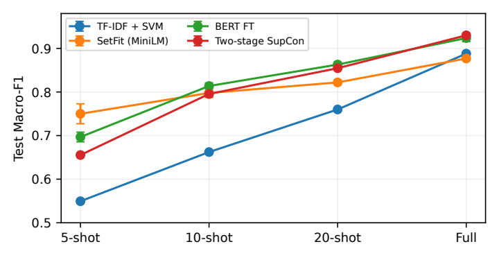
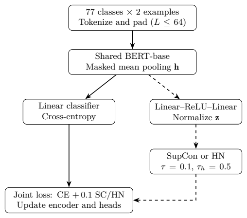
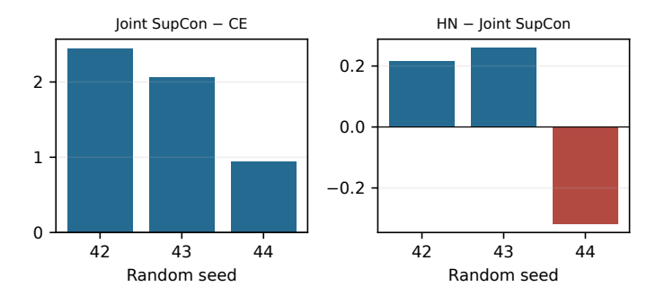

# 每类五条训练样本时，监督对比学习能否改善 BERT 的银行意图分类？

jingzhe FENG · 香港城市大学（东莞） · 学号：72655564

## 摘要

银行客服需要区分措辞相近、处理方式却不同的请求。当每种意图只有五条训练问句时，能够说明这些差别的例子很少。本文在 BANKING77 的 77 种意图上，以 TF-IDF 加线性 SVM 为基线，比较常规微调的 BERT 和使用带标签句子对训练的 SetFit。SetFit 的测试宏平均 F1 在三个种子上的均值最高，达到 75.00%。这一观察引出一个可单独检验的问题：利用问句之间的类别关系，能否也改善 BERT 的分类表现？我们固定训练样本、模型和训练设置，比较仅使用分类损失的 BERT 与额外加入监督对比损失的 BERT。三个随机种子下均有提升，测试宏平均 F1 的均值从仅用交叉熵训练时的 68.31% 升至 70.13%，提高了 1.82 个百分点。
**关键词：** 意图分类 ； 小样本学习 ； 监督对比学习 ； BANKING77

## 引言
客户说“刷卡时汇率算错了”和“取现时汇率算错了”，用词很接近，客服却需要核查不同的交易。要把请求分给合适的服务流程，分类器必须抓住“刷卡”或“取现”这样的细节。BANKING77 将这一任务具体化为 77 种银行意图的分类，共有 13,083 条带标签的英文问句 [1]。

每种意图只有五条训练问句时，分类器能见到的表达方式有限。我们以根据词和词组进行分类的 TF-IDF 加线性 SVM 为基线，与两种预训练模型比较。常规 BERT 根据整句内容预测意图 [2]；SetFit 还利用标签把问句配成对，学习哪些说法表达同一意图 [3]。在每类五条样本时，SetFit 得分最高。由于两者使用的编码器和训练流程都有差异，这一结果留下了一个问题：如果让 BERT 也学习问句之间的类别关系，它的分类表现会提高多少？

我们用两组训练条件相同的 BERT 回答这个问题。在每个随机种子下，两组使用同一批问句，都学习为每条问句预测标签。其中一组额外使用监督对比损失，让模型在表示空间中拉近同类问句 [4, 5]。采样、初始化、更新次数和检查点选择规则保持一致。作为补充，我们还考察给措辞或含义相近的异类问句更高训练权重是否有额外收益。

每类五条训练样本时，TF-IDF 加 SVM、常规 BERT 和 SetFit 的测试宏平均 F1 均值分别为 54.94%、69.68% 和 75.00%。实验 B 中，同条件下的 BERT 对照组得分为 68.31%。加入监督对比损失后，得分升至 70.13%，平均提高 1.82 个百分点，三个种子下均有提升。具体到 29 对预先指定的易混意图，只有一对在三个种子下的相互误判都减少了。

## 相关工作
**意图检测与句子编码器。**
Casanueva 等提出 BANKING77，研究细粒度单领域意图检测及有限标签条件下的高效双句子编码器 [1]，为使用密集意图体系而非粗粒度主题数据提供了依据。BERT 提供通用预训练表示，可联合调整任务头和编码器 [2]。SetFit 使用对比句对微调 Sentence Transformer，再训练下游分类器 [3]。其预训练表示和配对过程均与本文 BERT 方案不同，因此训练方案的优势不能仅归因于某个损失函数或编码器规模。

**监督对比目标。**
Khosla 等将同批次的所有同标签样本视为正样本，推广了对比学习 [4]。该目标约束表示几何结构，而交叉熵直接优化标签预测。Gunel 等研究预训练语言模型微调中的监督对比正则化 [5]，为联合分类与对比目标提供了先例。基于这一思路，本文检验其增量能否在 77 类、5-shot 的一致评估协议中保持，并考察全局改善是否延伸至指定混淆类别。

**从相似问句中学习。**
Robinson 等研究与当前样本难以区分的负样本 [6]。本文将这一思路用于补充分析，根据同一批次内的相似度给异类问句加权。对银行客服而言，实际困难在于每类可用的训练问句很少，却需要区分处理方式不同的请求。因此，我们既考察利用现有标签能否提高总体分类得分，也检查具体意图之间的误判是否减少。

## 方法
### 任务定义与共享端到端模型
设数据集为 $\mathcal D=\{(x_i,y_i)\}$，其中 $x_i$ 为话语，$y_i\in\{1,\ldots,77\}$ 为意图标签。$k$-shot 训练子集每类恰有 $k$ 条，共 $77k$ 条样本。分类器从 77 个领域内标签中选择一个，不涉及拒识、对话状态或交易执行。额外的有标签验证集单独报告，不计入 shot 数。

受控实验使用不区分大小写的预训练 BERT-base [2]，产生上下文标记表示 $\mathbf H_i\in\mathbb R^{L_i\times768}$。通过注意力掩码 $a_{it}$ 进行均值池化，非填充特殊标记也参与平均：
$$
\mathbf h_i=\frac{\sum_{t=1}^{L_i}a_{it}\mathbf H_{it}}{\sum_{t=1}^{L_i}a_{it}}.

$$
线性分类头预测 $\mathbf p_i=\operatorname{softmax}(\mathbf W_c\mathbf h_i+\mathbf b_c)$。批次大小为 $B$ 时，交叉熵为
$$
\mathcal L_{\mathrm{CE}}=-\frac1B\sum_{i=1}^B\log p_{i,y_i}.
$$
对比分支使用两个线性层和 ReLU，并归一化其 128 维输出：
$$
\mathbf u_i=\mathbf W_2\operatorname{ReLU}(\mathbf W_1\mathbf h_i+\mathbf b_1)+\mathbf b_2,
\qquad\mathbf z_i=\mathbf u_i/\|\mathbf u_i\|_2.
$$
三个受控实验分支均实例化两个头，保持初始化顺序一致；只有选定目标参与梯度计算。推理仅执行编码器、池化和分类头，不计算投影及负样本权重。

### 均衡采样与监督对比损失
每个批次从每类选取两个不同样本，故 $B=154$。每个锚点恰有一个同类正样本和 152 个异类负样本，从而保证正样本对存在；普通随机采样不提供这一保证。每轮对各类索引洗牌，并以“种子加轮数”重建加载器，确保同一种子下三个实验分支看到相同批次。在 5-shot 条件下，代码每轮形成两个批次，每类暂留一个样本未使用；后续洗牌改变被遗漏的样本。

令 $P(i)=\{p\ne i:y_p=y_i\}$，$A(i)=\{1,\ldots,B\}\setminus\{i\}$。记 $s_{ia}=\mathbf z_i^\top\mathbf z_a$，温度 $\tau=0.1$，代码实现的批次平均 SupCon 损失为
$$
\mathcal L_{\mathrm{SC}}=-\frac1B\sum_{i=1}^B\frac1{|P(i)|}\sum_{p\in P(i)}
\log\frac{\exp(s_{ip}/\tau)}{\sum_{a\in A(i)}\exp(s_{ia}/\tau)}.

$$
批次平均因子 $1/B$ 对理解联合损失系数至关重要。即使编码器使用 BF16，相似度、损失和 log-sum-exp 分母仍使用 float32。对角线自相似项被排除；没有正样本的锚点被屏蔽，但有效的均衡训练批次不会出现该情况。

### 动态负样本加权与联合目标
令 $N(i)=\{n:y_n\ne y_i\}$。对负样本定义停止梯度的权重
$$
w_{in}=|N(i)|\,
\frac{\exp(\operatorname{sg}(s_{in})/\tau_h)}{\sum_{b\in N(i)}\exp(\operatorname{sg}(s_{ib})/\tau_h)},
\qquad n\in N(i),

$$
其中 $\operatorname{sg}$ 表示停止梯度，加权温度为 $\tau_h=0.5$，正样本权重始终为 1。每行负样本权重均值为 1，因此该机制将负样本权重重新分配给更相似的实例，而非统一增加全部排斥作用。每步依据当前批次投影相似度重算权重，不使用验证标签质心。将式 (4) 的分母替换为 $\sum_{a\in A(i)}w_{ia}\exp(s_{ia}/\tau)$，得到 $\mathcal L_{\mathrm{HN}}$；负样本权重均匀时严格退化为普通 SupCon。

三个受控训练目标为
$$
\mathcal L=\begin{cases}
\mathcal L_{\mathrm{CE}},&\text{CE},\\
\mathcal L_{\mathrm{CE}}+0.1\mathcal L_{\mathrm{SC}},&\text{CE+SupCon},\\
\mathcal L_{\mathrm{CE}}+0.1\mathcal L_{\mathrm{HN}},&\text{CE+SupCon+HN}.
\end{cases}
$$
三组均端到端更新编码器和分类头。两阶段方案则先优化对比表示，随后冻结编码器、训练线性分类器。由于训练日程和冻结方式同时改变，该比较不能作为损失独立作用的受控估计。

### 实现细节
本文复用 BANKING77、BERT-base、SetFit、AdamW 和既有监督对比目标。数据与模型来源见 [1, 2, 3]，对比目标来源见 [4, 5]。具体工作包括一致的三分支实验协议、类别均衡加载器、归一化负样本加权、逐条预测审计及跨种子混淆分析。实现审计发现两阶段 HN 代码计算了加权分母，但最终损失仍使用此前的未加权值。本文因此排除全部 12 组受影响的 HN 运行，不将其用于方法结论；受控运行使用修复后的损失实现。

## 实验与结果
### 数据、评估与证据核验
BANKING77 官方数据包含 10,003 条训练查询和 3,080 条测试查询，测试集每类 40 条 [1]。项目按种子 42 从官方训练文件分层划分并修复同类重复文本组，得到 9,000 条训练池和固定 1,003 条验证集。每个种子从训练池抽取均衡的 5、10、20-shot 子集；全量条件使用全部训练池。同一种子下受控三组共享训练子集、有序数据指纹及预训练模型文件哈希。归一化（NFKC、小写、字母数字及撇号分词）用于重复审计，不替换模型原始输入。输入最长 64 个子词；受控实验不添加外部训练数据或合成话语。

主要指标为 77 类 F1 的算术平均值，即宏平均 F1；次要指标为准确率。由于测试集各类均有 40 条，准确率等于宏平均召回率，但不等于宏平均 F1。本文报告随机种子 42、43、44 的均值和样本标准差。先在同一种子内计算差值再取平均，避免相减已四舍五入的表格值。F1 单位乘以 100 转为百分点。三个种子支持描述性一致性检查，不足以单独建立普遍的统计显著性结论。

本文从保存的逐条预测独立重建 48 组非 HN 训练方案比较运行及 9 组受控运行的测试准确率和宏平均 F1，全部 57 组在 $10^{-10}$ 容差内与保存指标一致。此外，复算 9 组受控验证指标，核对跨分支的协议、数据和模型哈希，复核 174 条意图对错误记录，并将 12 个案例与原始预测行对应。该核验说明保存产物的数值一致，不等同于独立重训，也无法补回未保存的训练指纹或还原未记录的实现细节。

**数据重叠与验证标签预算。**
对所提供划分 CSV 的独立审计确认，训练池与官方测试集共享 19 条唯一归一化文本，验证与测试共享 6 条，训练与验证没有共享文本。重复来自官方数据；保留官方测试集可保持基准口径，但评估并非完全的文本不相交。本文披露重叠，不宣称完全无泄漏的泛化。5-shot 指 385 条训练标签，另有 1,003 条验证标签，而非总计只有 385 条标签。所有运行属于同一批实验，实验 A 与实验 B 区分的是分析协议，而非训练时期；验证集用于选取检查点，测试预测用于报告评估结果。

### 实验 A：以 TF-IDF 加 SVM 为基线比较分类方法
主要比较以 TF-IDF 加线性 SVM 为基线，另两种方法为常规 BERT 微调和使用 `all-MiniLM-L6-v2` 的 SetFit。表 1 还列出两阶段 BERT 对比训练结果，供补充比较。TF-IDF 特征包括单词和相邻词对。SetFit 小样本条件使用 20 次配对迭代、1 个训练轮、批次大小 16 和学习率 $2\times10^{-5}$。BERT 使用批次大小 32、权重衰减 0.01、预热比例 0.1；小样本训练至少 300 步，每 50 步验证，最多 1,000 步，并使用早停。保存的 BERT 学习率为 $5\times10^{-5}$；全量训练最多十轮，逐轮验证并早停。TF-IDF 使用次线性词频，小样本与全量的最小文档频数分别为 1 和 2；SVM 的 $C=1$，使用均衡类别权重，最多迭代 5,000 次。SetFit 全量条件仅使用一次配对迭代，因此曲线也反映了配对预算变化。

两阶段 SupCon 的 5-shot 配置以 $5\times10^{-5}$ 学习率和 0.1 温度进行 5 轮对比训练，再冻结编码器、以 $10^{-3}$ 学习率训练分类头最多 30 轮。这与 BERT 微调的数据暴露和优化过程有较大差异。因此，表 1 比较的是完整训练方案，既不隔离池化或损失，也未统一计算预算。

实验 A：测试宏平均 F1（百分制），三个种子的均值与样本标准差。粗体表示已评估方案中的最高均值，不代表统计显著胜出。排除存在实现缺陷的 HN 运行。

| Method | 5-shot | 10-shot | 20-shot | Full |
| --- | --- | --- | --- | --- |
| TF-IDF + SVM | 54.94 ± 0.40 | 66.22 ± 0.27 | 75.99 ± 0.31 | 88.79 ± 0.00 |
| SetFit | 75.00 ± 2.29 | 79.78 ± 1.05 | 82.19 ± 0.57 | 87.68 ± 0.49 |
| BERT FT | 69.68 ± 1.11 | 81.37 ± 0.71 | 86.29 ± 0.57 | 92.36 ± 0.81 |
| Two-stage SupCon | 65.54 ± 0.43 | 79.54 ± 0.61 | 85.45 ± 0.31 | 92.99 ± 0.48 |

实验 A 的标签预算曲线。误差棒表示三个种子的样本标准差；横轴为离散预算类别，不是按训练样本数线性排列。

每类五条训练样本时，词特征基线的宏平均 F1 为 54.94%，常规 BERT 达到 69.68%，SetFit 达到 75.00%。在这个预算下，SetFit 比 BERT 高 5.32 个百分点。增加样本后，排名发生变化。每类十条时 BERT 达到 0.8137，超过 SetFit 的 0.7978；每类二十条时两者分别为 0.8629 和 0.8219。使用全量训练池时，BERT、TF-IDF 加 SVM 和 SetFit 分别达到 0.9236、0.8879 和 0.8768。全量 SVM 在三个种子下使用相同的训练数据。

两阶段 SupCon 在 5、10、20-shot 下分别落后 BERT 4.14、1.82、0.84 个百分点。全量均值为 0.9299，比 BERT 高 0.63 个百分点，但其配对差值为 $0.0063\pm0.0123$ F1 单位，且一个种子为负。因此最高均值不足以说明一致优越性。编码器冻结和训练暴露差异是小样本劣势的可能解释，实验尚未证明表示坍缩或特定几何结构是其原因。

### 实验 B：监督对比损失与难负样本加权的受控消融
SetFit 在五样本条件下的表现引出了对样本配对的检验。我们比较只用交叉熵（CE）训练的 BERT 与同时使用交叉熵和监督对比损失的 BERT。计算增益时，参照值取表 2 中仅使用 CE 的一组（0.6831）。表 1 中常规 BERT 的 0.6968 来自另一套批次大小和停止规则。第三组在监督对比学习的基础上额外给难负样本加权，用于补充分析。

受控协议固定 BERT-base、掩码均值池化、128 维 ReLU 投影、有效批次大小 154、AdamW 学习率 $5\times10^{-5}$ 和权重衰减 0.01。恰好训练 300 次更新，不使用早停或学习率调度器，每 50 步验证，并恢复验证宏平均 F1 最高的完整模型状态。三个分支共享初始化顺序及种子加轮数生成的批次。硬件为 WSL2 下的 NVIDIA RTX 5060 Ti 16 GB，开启 BF16、缩放点积注意力和梯度检查点。对比损失系数、SupCon 温度及 HN 温度分别为 0.1、0.1、0.5。 图 2 展示三组共享的分类路径及可选的对比分支。

实验 B 的 BERT 训练流程。左路预测意图。训练时可增加右路，将问句投影后比较，使用普通监督对比损失（SupCon）或难负样本加权版本（HN）。预测时依次进行分词、编码、均值池化和分类。投影和负样本加权仅用于训练。

5-shot 受控结果，三个种子。耗时包含训练及周期验证；吞吐为预热后的测试推理，含批次装载和分数回传，不含分词及模型加载。显存为 PyTorch 峰值已分配显存。

| Objective | Macro-F1 | Time (s) | Samples/s | GiB |
| --- | --- | --- | --- | --- |
| CE | 0.6831 ± 0.0112 | 83.9 | 3448.7 | 2.13 |
| CE+SupCon | 0.7013 ± 0.0050 | 84.2 | 3442.0 | 2.14 |
| CE+SupCon+HN | 0.7019 ± 0.0034 | 84.3 | 3452.7 | 2.14 |

CE+SupCon 将宏平均 F1 从 0.68315 提升至 0.70135，配对平均增益为 1.820 个百分点；种子 42、43、44 分别增加 2.447、2.067、0.946 个百分点。跨种子标准差从 CE 的 0.0112 降为 0.0050。准确率和 F1 均基于同一逐条预测复算；标准差更小本身不能解释均值上升，也不能建立总体稳健性。结果支持本协议中的正则化增量，但不表示该配置优于另一个协议中的 SetFit。

HN 的未舍入均值仅增加 0.0005266 F1 单位，即 0.053 个百分点。三个种子的变化为 $+0.216$、$+0.259$、$-0.317$ 个百分点，配对标准差为 0.321 个百分点。用四位小数表格相减得到的 0.06 个百分点是舍入造成的差异。本文因此认为该加权在三个已评估种子下没有一致额外增益，而非所有难负样本挖掘均无效。图 3 展示增益规模和符号变化。

实验 B 的配对种子差值，单位为百分点。两个子图采用不同纵轴尺度以显示微小 HN 效应。CE+SupCon 的差值均为正，HN 的差值有正有负。

CE、CE+SupCon 和 CE+SupCon+HN 的训练及周期验证平均耗时分别为 83.9、84.2、84.3 秒，峰值已分配显存约为 2.13、2.14、2.14 GiB；测试吞吐量分别为 3448.7、3442.0、3452.7 条/秒。没有独立重复计时来刻画设备负载和测量噪声，因此不应将这些微小差异解释为确定的速度排名。由于推理时不调用投影和 HN 分支，三个模型的推理计算路径相同；这支持“没有额外推理操作”，不意味着任何硬件上的实测延迟差都严格为零。

### 混淆意图审计与真实案例
对预定义类别对 $(a,b)$，双向错误数为
$$
E_{ab}=\#\{y=a,\hat y=b\}+\#\{y=b,\hat y=a\}.
$$
仅 $\Delta E_{ab}<0$ 视为改善，持平不算改善。项目根据语义定义八组共 29 对意图，固定后开展分析，而非根据最大观测收益选择类别对。每类测试仅 40 条，双向错误可能很少，持平情况常见。因此同时报告平均错误变化及三个种子下是否均为负。这是全局 F1 的诊断补充，不是多重比较显著性检验。

受控混淆审计。错误变化为处理组减基线，负值更好。“一致”表示同一类别对在三个种子下均同向变化。最后一列为 29 对意图各自平均错误变化量之和。

| 比较 | 一致改善 | 一致恶化 | 总 $\Delta E$ |
| --- | --- | --- | --- |
| CE+SupCon 相对 CE | 1/29 | 2/29 | $+2.0$ |
| HN 相对 CE+SupCon | 0/29 | 0/29 | $+2.0$ |

CE+SupCon 的受控审计中有一对一致改善，两对一致恶化。改善的一对是银行转账后余额未更新与支票或现金存入后余额未更新。HN 则既没有一致改善对，也没有一致恶化对，其平均双向错误变化合计为 $+2.0$。因此，两个对照的混淆统计需要分别解读。总体 F1 提升或个别有利查询均不足以证明指定语义歧义已被普遍解开；没有全种子改善也不等于完全没有类别对效应。

表 4 使用真实种子 42 预测。按测试集原始顺序，为每个相邻方法比较选取较早出现的改善、恶化和共同失败案例；这些案例用于说明行为，不用于估计发生频率。为保持与数据对应，保留原始英文查询，缩略标签在表注中定义。

真实种子 42 测试案例。

| 查询 | 真值 | 比较 | 预测变化 |
| --- | --- | --- | --- |
| “still waiting on that card” | A | CE $\to$ SC | L $\to$ A |
| “The exchange rate on my purchase is wrong.” | P | CE $\to$ SC | P $\to$ W |
| “How do I locate my card?” | A | CE $\to$ SC | L $\to$ D |
| “Does the card you sent have a way to track to it?” | A | SC $\to$ HN | D $\to$ A |
| “Tell me which cards and what currency is supported.” | S | SC $\to$ HN | S $\to$ F |

A：卡片到达；L：卡片丢失或被盗；D：卡片配送时间估计；P：刷卡支付汇率错误；W：现金提取汇率错误；S：支持的卡片及货币；F：法定货币支持。SC 为 CE+SupCon。

第一例表明，对比联合训练可以在词汇信息很少时恢复配送语境。购物汇率失败案例说明交易类型仍难区分：相似汇率词汇可能盖过“purchase”的线索。卡片位置查询缺少上下文，本身存在歧义，两种模型都未命中数据标签。HN 修正了一个追踪查询，却将“卡片及货币”的组合请求误判为较窄的货币支持。这些相反案例与微小且符号不一致的 HN 总体变化相符，并不能证明编码器发生几何坍缩。

### 局限与实践含义
本研究仅覆盖一个英文领域内分类数据集、三个种子和一种受控 5-shot 预算，未评估领域外检测、多语言、多轮澄清、金融安全或实际分流成本。验证标签数多于 5-shot 训练标签数，因此样本效率应在这一条件下理解。官方划分的重复文本可能使结果对全新查询偏乐观。文本不相交的重跑，以及受控 10-shot、20-shot、全量扩展可进一步检验泛化，但当前没有这些结果，也不由已有表格暗示其存在。

训练方案比较适合支持这些实现之间的选型，但架构与优化混杂，不能将全量数据排名解释为损失的因果消融。受控实验在一个共享配方下隔离目标函数增量，损失系数和温度固定，未对各分支分别充分调优。更多调参可能改变结果，但基于已经查看的测试集调参会损害评估有效性。因此本文保留 HN 的负面发现，同时不声称普遍等效。

## 结论
在 BANKING77 上，每类只有五条训练样本时，SetFit 在所比较的方案中得分最高。它对句子配对的利用，引出了本文对 BERT 的受控检验。在相同的五样本训练条件下，加入监督对比损失使 BERT 的测试宏平均 F1 均值从 68.31% 升至 70.13%，三个种子均有提升。因此，对本文的 BERT 配置而言，用同一批标签同时学习“每句属于哪一类”和“哪些句子属于同一类”，能改善整体分类表现。29 对指定意图中，只有 1 对在三个种子下的相互误判均减少，另有 2 对均增加。这一结论的适用范围是一个英文数据集和一种受控训练预算。

## 参考文献

1. Casanueva, I., Temčinas, T., Gerz, D., Henderson, M., Vulić, I.: Efficient intent detection with dual sentence encoders. In: Proceedings of the 2nd Workshop on Natural Language Processing for Conversational AI, pp. 38--45 (2020). [原文](https://aclanthology.org/2020.nlp4convai-1.5/)

2. Devlin, J., Chang, M.-W., Lee, K., Toutanova, K.: BERT: Pre-training of deep bidirectional transformers for language understanding. In: NAACL-HLT, pp. 4171--4186 (2019). [原文](https://aclanthology.org/N19-1423/)

3. Tunstall, L., Reimers, N., Jo, U.E.S., Bates, L., Korat, D., Wasserblat, M., Pereg, O.: Efficient few-shot learning without prompts. arXiv:2209.11055 (2022). [原文](https://arxiv.org/abs/2209.11055)

4. Khosla, P., Teterwak, P., Wang, C., Sarna, A., Tian, Y., Isola, P., Maschinot, A., Liu, C., Krishnan, D.: Supervised contrastive learning. Advances in Neural Information Processing Systems 33, 18661--18673 (2020). [原文](https://arxiv.org/abs/2004.11362)

5. Gunel, B., Du, J., Conneau, A., Stoyanov, V.: Supervised contrastive learning for pre-trained language model fine-tuning. In: ICLR (2021). [原文](https://arxiv.org/abs/2011.01403)

6. Robinson, J., Chuang, C.-Y., Sra, S., Jegelka, S.: Contrastive learning with hard negative samples. In: ICLR (2021). [原文](https://arxiv.org/abs/2010.04592)
